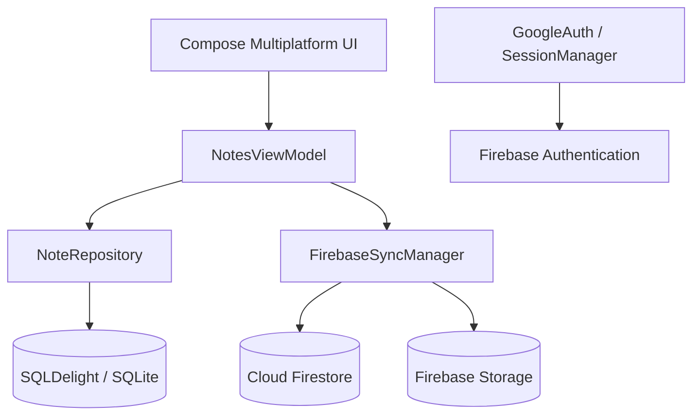

# Notes — кроссплатформенное приложение для заметок

**Notes** — дипломный проект, посвящённый разработке приложения для создания и управления заметками с облачной синхронизацией между **Android** и **Windows**.

Приложение позволяет хранить текстовые записи, прикреплять к ним изображения и файлы, а затем получать актуальные данные на другом устройстве. Для этого используется единая кодовая база на Kotlin Multiplatform, локальное хранилище SQLite и облачные сервисы Firebase.

## Цель проекта

Цель работы — разработать кроссплатформенное приложение для ведения заметок с поддержкой вложений и синхронизацией пользовательских данных между мобильным устройством и компьютером.

Основная инженерная задача — повторно использовать бизнес-логику и пользовательский интерфейс на нескольких платформах, не создавая две независимые реализации приложения. Это упрощает сопровождение проекта и уменьшает дублирование кода.

## Возможности

- **Авторизация через Google.** Вход выполняется с помощью Google-аккаунта через Firebase Authentication.
- **Управление заметками.** Создание, просмотр и редактирование заметок с заголовком и текстовым содержимым.
- **Избранное.** Возможность отмечать важные заметки.
- **Вложения.** Добавление к заметкам изображений, видео и других файлов. Вложения можно открывать стандартными средствами операционной системы.
- **Корзина.** Удалённые заметки перемещаются во временную корзину, откуда их можно восстановить.
- **Автоматическая очистка.** Устаревшие записи в корзине удаляются по истечении установленного срока.
- **Локальное хранение.** Заметки сохраняются в SQLite на устройстве.
- **Облачная синхронизация.** Изменения заметок и вложений передаются в Firebase и становятся доступны на других устройствах пользователя.
- **Работа без постоянного подключения к сети.** Заметки можно создавать и редактировать локально; синхронизация выполняется при наличии соединения.

## Поддерживаемые платформы

| Платформа | Реализация |
| --- | --- |
| Android | Мобильное приложение |
| Windows | Настольное приложение на JVM (Desktop) |

В рамках дипломной работы приложение разрабатывалось и проверялось на Android и Windows. Конфигурация iOS в текущем Gradle-проекте не включена.

## Технологический стек

| Технология | Назначение |
| --- | --- |
| **Kotlin** | Основной язык разработки |
| **Kotlin Multiplatform (KMP)** | Общая кодовая база и повторное использование бизнес-логики |
| **Compose Multiplatform** | Общий декларативный пользовательский интерфейс |
| **SQLDelight** | Типобезопасный доступ к локальной базе данных SQLite |
| **Firebase Authentication** | Авторизация пользователя через Google |
| **Cloud Firestore** | Облачное хранение данных заметок |
| **Firebase Storage** | Хранение файлов, прикреплённых к заметкам |
| **Ktor Client** | HTTP-взаимодействие с Firebase REST API |
| **Ktor Netty** | Локальный HTTP-сервер для OAuth-потока на Desktop |
| **Kotlin Coroutines и StateFlow** | Асинхронные операции и управление состоянием приложения |
| **kotlinx.serialization** | Сериализация данных при сетевом взаимодействии |
| **Gradle (Kotlin DSL)** | Сборка проекта и управление зависимостями |

## Архитектура

Приложение построено с использованием подхода **MVVM** и разделением ответственности между пользовательским интерфейсом, логикой представления, слоем доступа к данным и синхронизацией.



### Основные компоненты

- **`NotesViewModel`** — управляет состоянием экранов и обрабатывает действия пользователя: сохранение, изменение, удаление, восстановление заметок и работу с избранным.
- **`NoteRepository`** — инкапсулирует операции чтения и изменения заметок и вложений в локальной базе данных.
- **`NotesDatabase`** — база SQLDelight с таблицами заметок и вложений.
- **`FirebaseSyncManager`** — отвечает за загрузку и выгрузку заметок и вложений между устройством и облаком.
- **`GoogleAuth` и `SessionManager`** — реализуют вход пользователя и сохранение пользовательской сессии.
- **Платформенные реализации** — обеспечивают вызов системных возможностей Android и Desktop, например выбор и открытие файлов, а также платформенный сценарий авторизации.

Общая логика и интерфейс размещены в `commonMain`, а платформенно-зависимый код — в соответствующих source set для Android и JVM.

### Модель данных

Основные сущности приложения:

- **`Note`** — заметка с идентификатором, заголовком, содержимым, временем изменения, признаками избранного и логического удаления, а также отметкой последней синхронизации.
- **`Attachment`** — вложение, связанное с заметкой. Для него хранятся идентификатор заметки, путь к файлу, имя, MIME-тип и категория (изображение, видео или файл).

Связь между заметкой и вложениями имеет тип «один ко многим»: одна заметка может содержать несколько файлов.

## Как работает синхронизация

1. Пользователь входит в приложение через Google.
2. После авторизации приложение выполняет начальную синхронизацию с облачной коллекцией пользователя в Firestore.
3. Если заметки уже есть в облаке, они загружаются в локальную базу. Если облачная коллекция пуста, локальные заметки отправляются в облако.
4. При последующем создании, редактировании, удалении, восстановлении заметки или изменении её статуса избранного обновляется соответствующий документ Firestore.
5. Файлы, прикреплённые к заметкам, хранятся в Firebase Storage; информация о вложениях связывается с соответствующей заметкой.

Локальная база позволяет работать с заметками на устройстве без постоянного доступа к интернету. Облачная копия используется для переноса данных между устройствами, связанными с одной учётной записью.

## Структура проекта

```text
Notes/
├── composeApp/
│   └── src/
│       ├── commonMain/   # Общий интерфейс, модели, бизнес-логика и контракты
│       ├── androidMain/  # Реализация для Android
│       └── jvmMain/      # Реализация Desktop/JVM
├── gradle/
│   └── libs.versions.toml  # Версии библиотек и Gradle-плагины
├── build.gradle.kts
├── settings.gradle.kts
├── gradle.properties
├── gradlew
└── gradlew.bat
```

Основной код приложения находится в модуле `composeApp`.

## Сборка и запуск

### Требования

- JDK, совместимый с используемой версией Android Gradle Plugin;
- Android Studio или IntelliJ IDEA с поддержкой Kotlin Multiplatform;
- Android SDK и эмулятор либо физическое Android-устройство — для запуска мобильной версии;
- настроенный проект Firebase для авторизации и облачного хранения данных.

### Настройка Firebase

Перед запуском необходимо подключить собственный проект Firebase и настроить:

1. **Firebase Authentication** с провайдером Google;
2. **Cloud Firestore** для хранения заметок;
3. **Firebase Storage** для хранения вложений;
4. OAuth-клиент и параметры авторизации, необходимые для используемых платформ.

Используйте конфигурацию своего проекта Firebase и собственные OAuth-параметры. Не публикуйте приватные ключи, токены и другие секретные данные в открытом репозитории.

### Запуск Desktop-версии (Windows)

В корне проекта выполните:

```powershell
.\gradlew.bat :composeApp:run
```

### Сборка Android-приложения

В корне проекта выполните:

```powershell
.\gradlew.bat :composeApp:assembleDebug
```

После успешной сборки APK можно установить на подключённое устройство или запустить приложение из Android Studio.

Для macOS/Linux используются соответствующие команды Gradle Wrapper:

```bash
./gradlew :composeApp:run
./gradlew :composeApp:assembleDebug
```

## Тестирование

В рамках дипломной работы проводилось ручное тестирование интерфейса и основных пользовательских сценариев на **Windows 10** и **Android API 29**.

Проверялись:

- авторизация и переходы между экранами;
- создание, редактирование, удаление и восстановление заметок;
- добавление и открытие изображений, PDF- и текстовых файлов;
- работа с заметками при отсутствии сети и последующая синхронизация;
- передача заметок между экземплярами приложения на Android и Windows.

По результатам проведённого ручного тестирования критических дефектов не выявлено; реализованные функции, описанные в дипломной работе, прошли проверку.

## Результат

В результате выпускной квалификационной работы разработано приложение для ведения заметок, работающее на Windows и Android и использующее общую кодовую базу Kotlin Multiplatform. Реализованы авторизация через Google, локальное хранение заметок, работа с вложениями, временная корзина и облачная синхронизация через Firebase.

Проект демонстрирует практическое применение Kotlin Multiplatform и Compose Multiplatform для создания приложения с общим пользовательским интерфейсом и бизнес-логикой на нескольких платформах.

## Дальнейшее развитие

В качестве направлений дальнейшего развития в дипломной работе рассматриваются поиск по заметкам, теги, шифрование данных и возможное добавление поддержки iOS.
